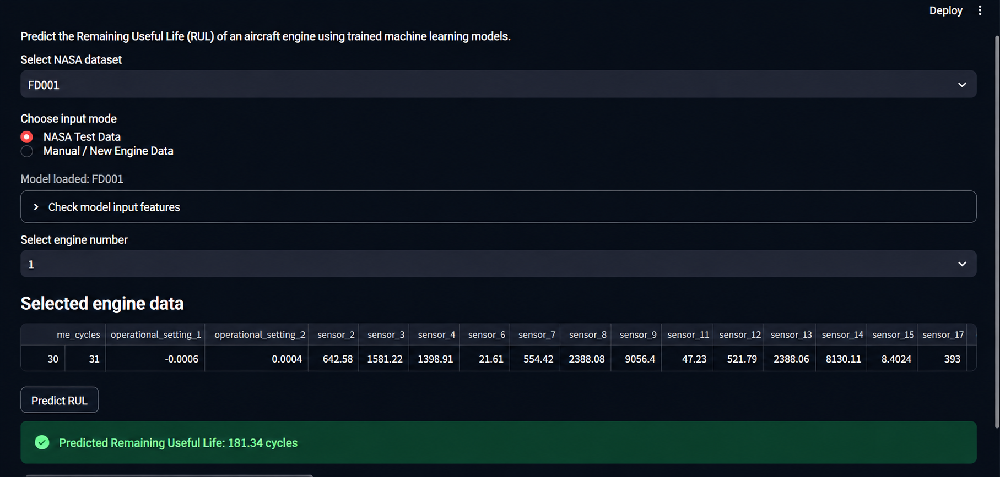
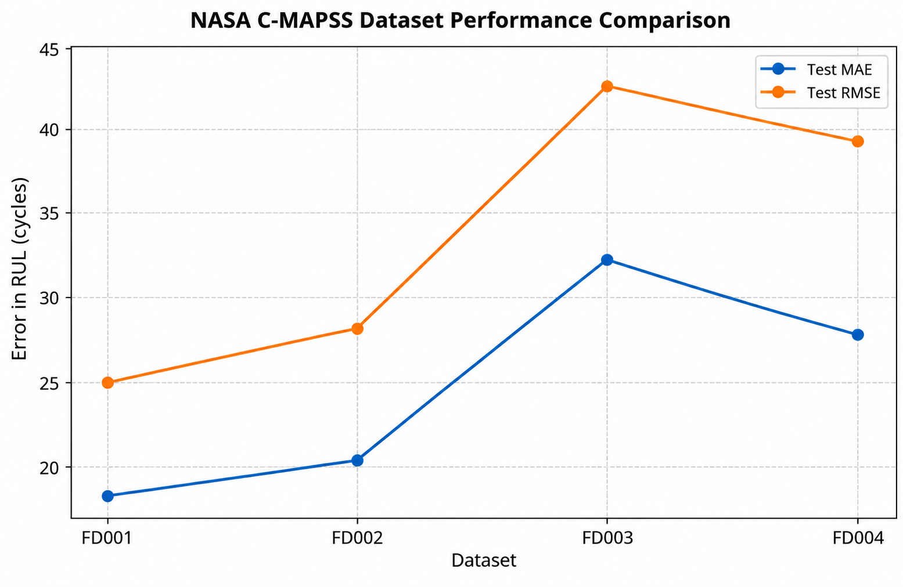
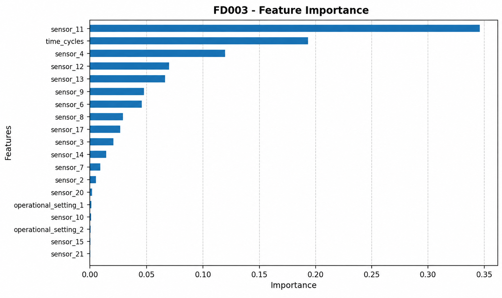

# ✈️ Predictive Maintenance & Remaining Useful Life (RUL) Prediction

**Machine Learning | NASA C-MAPSS | Python | Scikit-learn | Streamlit**

A machine learning project that predicts the Remaining Useful Life (RUL) of turbofan engines using NASA's C-MAPSS engine degradation simulation dataset. The project covers data preprocessing, feature engineering, regression model development, performance evaluation, and an interactive Streamlit dashboard.

---

## 📌 Table of Contents

- [Project Overview](#-project-overview)
- [Objectives](#-objectives)
- [Dataset](#-dataset)
- [Project Workflow](#-project-workflow)
- [Technologies Used](#-technologies-used)
- [Machine Learning Models](#-machine-learning-models)
- [Model Performance](#-model-performance)
- [Visualizations](#-visualizations)
- [Streamlit Dashboard](#-streamlit-dashboard)
- [Project Structure](#-project-structure)
- [Installation](#-installation)
- [How to Run](#-how-to-run)
- [Key Findings](#-key-findings)
- [Future Improvements](#-future-improvements)
- [References](#-references)
- [Author](#-author)

---

## 🚀 Project Overview

Aircraft engines operate under demanding conditions. Unexpected failures can cause costly maintenance, operational delays, and safety concerns.

Predictive maintenance uses historical operating data and machine learning to estimate equipment degradation and support maintenance planning before failure occurs.

This project uses NASA's C-MAPSS turbofan engine degradation simulation dataset to develop regression models that estimate an engine's remaining useful life based on operational settings and sensor measurements.

The project evaluates four datasets — FD001, FD002, FD003, and FD004 — and uses Random Forest and Gradient Boosting regression models to estimate RUL.

### 🎯 Objectives

- 📂 Analyze the four NASA C-MAPSS datasets.
- 🧹 Preprocess engine sensor readings and operational settings.
- ⚙️ Prepare Remaining Useful Life targets for supervised learning.
- 🔧 Perform feature engineering.
- 🤖 Train and compare machine learning regression models.
- 📊 Evaluate predictions using MAE and RMSE.
- ✈️ Estimate the remaining useful life of turbofan engines.
- 🖥️ Present predictions and model results through a Streamlit dashboard.

---

## 📊 Dataset

This project uses the **NASA C-MAPSS Turbofan Engine Degradation Simulation Dataset**.

📥 **Official dataset download:**

[Download NASA C-MAPSS Dataset (ZIP)](https://phm-datasets.s3.amazonaws.com/NASA/6.+Turbofan+Engine+Degradation+Simulation+Data+Set.zip)

The dataset contains simulated turbofan engine run-to-failure data, including engine identifiers, operating cycles, operational settings, and sensor measurements.

### Dataset Files

Each of the four subsets includes training data, test data, and a corresponding RUL file containing reference targets for the test engines.

| Dataset | Training file | Test file | Test RUL file |
|---|---|---|---|
| FD001 | `train_FD001.txt` | `test_FD001.txt` | `RUL_FD001.txt` |
| FD002 | `train_FD002.txt` | `test_FD002.txt` | `RUL_FD002.txt` |
| FD003 | `train_FD003.txt` | `test_FD003.txt` | `RUL_FD003.txt` |
| FD004 | `train_FD004.txt` | `test_FD004.txt` | `RUL_FD004.txt` |

### Dataset Characteristics

| Dataset | Operating conditions | Fault modes |
|---|---|---|
| FD001 | Single | Single |
| FD002 | Multiple | Single |
| FD003 | Single | Multiple |
| FD004 | Multiple | Multiple |

### Role of the RUL Files

- **Training files:** Contain engine operating cycles and sensor readings used to train the models. RUL targets can be derived from the run-to-failure training trajectories.
- **Test files:** Contain sensor readings for test engines up to their last observed cycles.
- **RUL files:** Provide reference remaining useful life values for the corresponding test engines and can be used to evaluate predictions.

The four subsets enable model evaluation under different operating conditions and fault modes.

---

## 🔄 Project Workflow

```text
              ✈️ NASA C-MAPSS Dataset
                         |
                         v
                  📂 Data Loading
                         |
                         v
             🔍 Exploratory Data Analysis
                         |
                         v
                 🧹 Data Preprocessing
                         |
                         v
                 ⚙️ RUL Target Creation
                         |
                         v
                 🔧 Feature Engineering
                         |
                         v
                  📊 Train-Test Split
                         |
                         v
                  🤖 Model Training
                         |
                         v
                📈 Model Evaluation
                   (MAE and RMSE)
                         |
                         v
                  🏆 Model Selection
                         |
                         v
                   ✈️ RUL Prediction
                         |
                         v
                🖥️ Streamlit Dashboard
```

### Workflow Description

1. **Data loading:** Load the FD001, FD002, FD003, and FD004 datasets.
2. **Exploratory data analysis:** Examine sensor measurements, operating conditions, engine cycles, and degradation patterns.
3. **Data preprocessing:** Prepare sensor and operational data for machine learning.
4. **RUL target creation:** Generate training targets from the run-to-failure data and use the supplied RUL files as test reference targets.
5. **Feature engineering:** Prepare relevant features for regression modelling.
6. **Model training:** Train Random Forest and Gradient Boosting regressors.
7. **Model evaluation:** Measure prediction errors using MAE and RMSE.
8. **Model selection:** Select a model for each dataset based on the evaluated results.
9. **RUL prediction:** Estimate the remaining useful life of an engine.
10. **Dashboard:** Present prediction results and visualizations through Streamlit.

---

## 🛠️ Technologies Used

| Technology | Purpose |
|---|---|
| Python | Core programming language |
| Pandas | Data manipulation and preprocessing |
| NumPy | Numerical computation |
| Scikit-learn | Model training and evaluation |
| Matplotlib | Data visualization |
| Seaborn | Statistical visualization |
| Jupyter Notebook | Experimentation and analysis |
| Streamlit | Interactive dashboard |

---

## 🤖 Machine Learning Models

### 1. Random Forest Regressor

Random Forest combines predictions from multiple decision trees to estimate RUL. It can model nonlinear relationships between engine sensor readings and degradation.

**Selected model for:** FD002 and FD004.

### 2. Gradient Boosting Regressor

Gradient Boosting builds decision trees sequentially, with each successive tree learning to reduce the errors made by the existing ensemble.

**Selected model for:** FD001 and FD003.

### Evaluation Metrics

**Mean Absolute Error (MAE)**

Measures the average absolute difference between actual and predicted RUL. Lower values indicate smaller average errors.

**Root Mean Squared Error (RMSE)**

Measures the square root of the average squared prediction error. Larger prediction errors have a greater effect on this metric.

For both metrics, lower values indicate better predictive performance when the evaluation setup is comparable.

---

## 📈 Model Performance

The following table presents the reported independent test results for the selected models.

| Dataset | Selected Model | Test MAE | Test RMSE |
|---|---|---:|---:|
| FD001 | Gradient Boosting | 18.18 | 24.86 |
| FD002 | Random Forest | 20.34 | 28.14 |
| FD003 | Gradient Boosting | 32.25 | 42.50 |
| FD004 | Random Forest | 27.96 | 39.42 |

### Performance Insights

- **FD001** achieved the lowest reported MAE and RMSE.
- **FD003** recorded the highest reported prediction errors.
- Gradient Boosting was selected for FD001 and FD003.
- Random Forest was selected for FD002 and FD004.

These results represent this project's evaluation. Comparisons with other implementations require consistent preprocessing, RUL definitions, and evaluation procedures.

---

## 📉 Visualizations

The following visualizations are stored in the repository's `images/` directory.

### 1. ✈️ Streamlit RUL Prediction Dashboard



**Image path:** `images/streamlit_prediction.png`

### 2. 📊 Model Performance Comparison



**Image path:** `images/model-performance.png`

### 3. 🔍 Feature Importance — FD003



**Image path:** `images/feature_importance_fd003.png`

### 4. 📈 Actual vs. Predicted RUL — FD003


**Image path:** `images/actal vs predicted fd003.png`

**Important:** The image filenames above retain the names you provided. GitHub requires the paths to match the uploaded filenames exactly, including spelling, spaces, underscores, hyphens, and capitalization.

---

## 🖥️ Streamlit Dashboard

The Streamlit application provides an interface for displaying RUL predictions and model evaluation results.


The dashboard complements the model analysis by presenting results visually.

To launch the application locally, run:

```bash
streamlit run app.py
```

The command assumes your Streamlit entry-point file is named `app.py`.

---

## 📁 Project Structure

The following is the expected project structure based on the filenames and folders discussed for this project. Keep the structure consistent with the files actually present in your repository.

```text
turbofan_engine_project/
│
├── README.md
├── app.py
├── main.py
├── predictive_maintenance.ipynb
├── requirements.txt
│
├── CMAPS_Data/
│   ├── train_FD001.txt
│   ├── train_FD002.txt
│   ├── train_FD003.txt
│   ├── train_FD004.txt
│   ├── test_FD001.txt
│   ├── test_FD002.txt
│   ├── test_FD003.txt
│   ├── test_FD004.txt
│   ├── RUL_FD001.txt
│   ├── RUL_FD002.txt
│   ├── RUL_FD003.txt
│   └── RUL_FD004.txt
│
├── models/
│   └── Trained model files
│
└── images/
    ├── streamlit_prediction.png
    ├── model-performance.png
    ├── feature_importance_fd003.png
    └── actal vs predicted fd003.png
```

---

## ⚙️ Installation

### Prerequisites

- Python
- pip
- Git (optional)

### 1. Clone the repository

```bash
git clone <YOUR_GITHUB_REPOSITORY_URL>
cd turbofan_engine_project
```

### 2. Create a virtual environment

**Windows**

```bash
python -m venv venv
venv\Scripts\activate
```

**macOS / Linux**

```bash
python3 -m venv venv
source venv/bin/activate
```

### 3. Install dependencies

If the project contains a `requirements.txt` file:

```bash
pip install -r requirements.txt
```

Otherwise, install the required libraries:

```bash
pip install pandas numpy scikit-learn matplotlib seaborn streamlit jupyter
```

---

## ▶️ How to Run

### Run the analysis notebook

```bash
jupyter notebook predictive_maintenance.ipynb
```

### Run the main Python script

```bash
python main.py
```

### Launch the Streamlit dashboard

```bash
streamlit run app.py
```

Open the local URL printed in the terminal to access the dashboard.

These commands assume the corresponding files exist in your project directory.

---

## 🔑 Key Findings

- Tree-based regression models can estimate RUL from simulated engine sensor data.
- The selected model differed across the four evaluated datasets.
- FD001 achieved the lowest reported test errors.
- FD003 had the highest reported test errors among the four subsets.
- Combining regression models with visualizations helps communicate predictive maintenance results.

---

## 🔮 Future Improvements

- Evaluate XGBoost and LightGBM regression models.
- Explore LSTM and other sequence-based models for time-series sensor data.
- Perform systematic hyperparameter tuning.
- Improve feature selection and sensor trend analysis.
- Add prediction uncertainty estimates.
- Enhance the dashboard with engine-level degradation trends.
- Deploy the application to a cloud platform.

---

## 📚 References

1. A. Saxena and K. Goebel (2008). *Turbofan Engine Degradation Simulation Data Set*. NASA Prognostics Data Repository, NASA Ames Research Center, Moffett Field, CA.
2. [NASA C-MAPSS Dataset — Official Download](https://phm-datasets.s3.amazonaws.com/NASA/6.+Turbofan+Engine+Degradation+Simulation+Data+Set.zip)
3. [Scikit-learn Documentation](https://scikit-learn.org/stable/)
4. [Streamlit Documentation](https://docs.streamlit.io/)

---

## 👨‍💻 Author

**Akhil M**

Mechanical Engineering Graduate | Machine Learning | Predictive Maintenance | Data Analytics

---

⭐ If you find this project useful, consider giving the repository a star!
